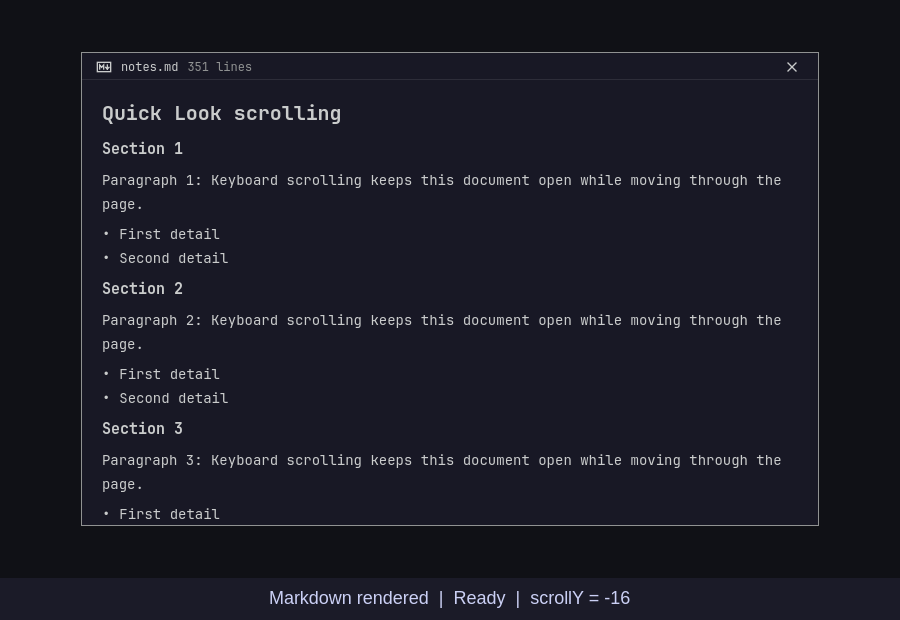
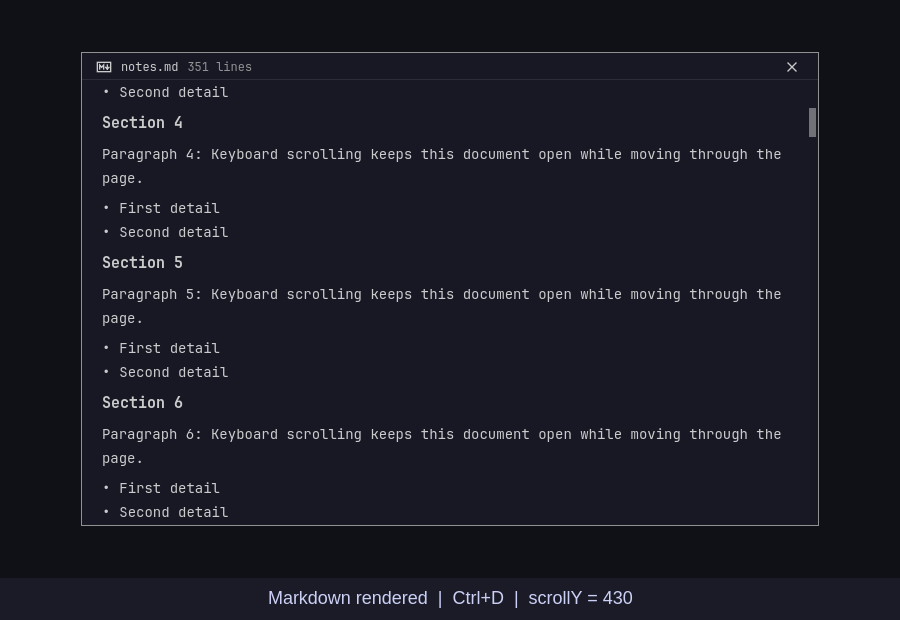
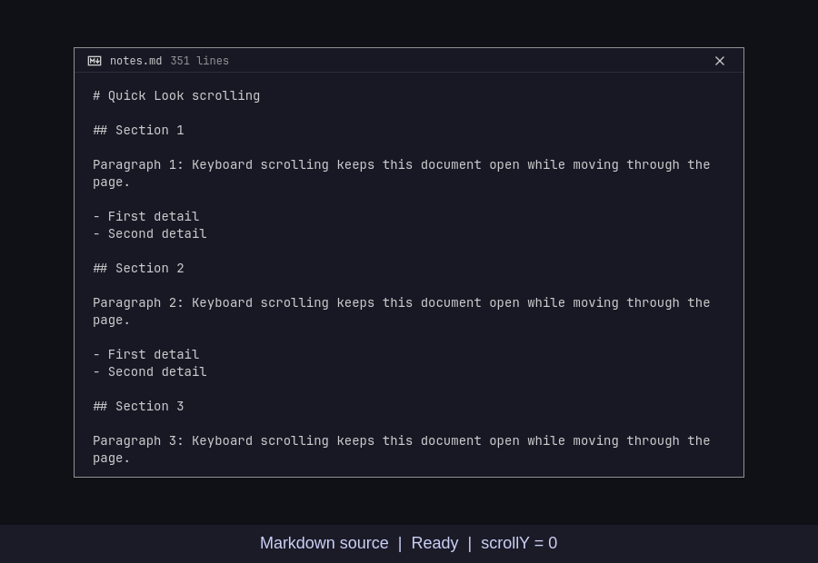
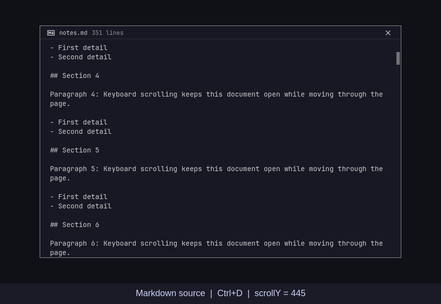
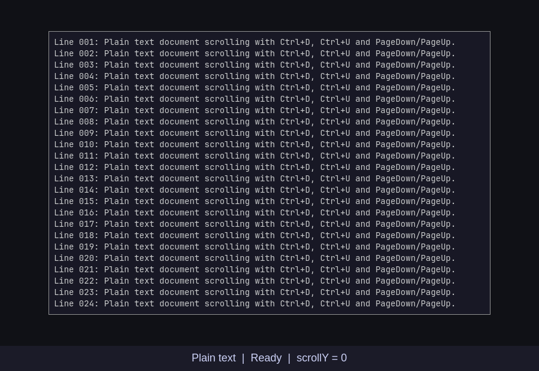
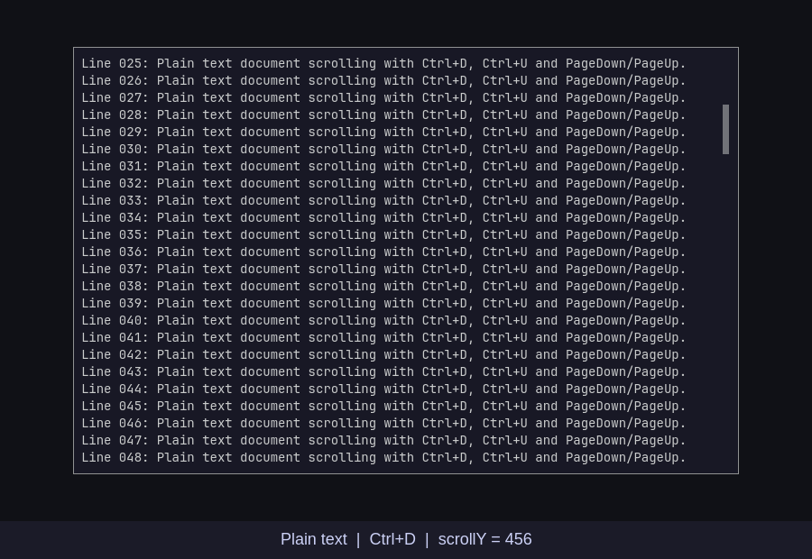

# Quick Look keyboard scrolling evidence

Visual evidence for [thisisgm/flea#273](https://github.com/thisisgm/flea/pull/273), captured with source commit `6e6411fa4ee2c0c12263a280f57d73c20997df8f`.

[Play the 15-second recording](quick-look-scroll.mp4).

The recording shows two Ctrl+D presses, Ctrl+U and PageDown in rendered Markdown, Markdown Source and plain text. The footer identifies the active view, the last key and the current scrollY.

| View | Before | After two Ctrl+D presses |
| --- | ---: | ---: |
| Rendered Markdown | -16 | 430 |
| Markdown Source | 0 | 445 |
| Plain text | 0 | 456 |

The negative starting offset in rendered Markdown is its top margin. Each screenshot pair uses the same viewport and fixture document.

| View | Initial viewport | After scrolling |
| --- | --- | --- |
| Rendered Markdown |  |  |
| Markdown Source |  |  |
| Plain text |  |  |

This is an offscreen capture of the shipped Quick Look components. Real Qt key events pass through the shipped Focus handler with a stubbed listing owner. It demonstrates document scrolling; it does not record the native compositor or loading the next directory file. The fixture contains no personal files.

Focused validation on the PR branch passed 44 scrolling checks, 674 keymap checks, keymap generation, all seven static gates and file budgets. The Markdown render suite also completed 300 teardown rounds. The 44-check regression test separately verifies both scroll bounds, bare cursor navigation and Space/Escape closure.
